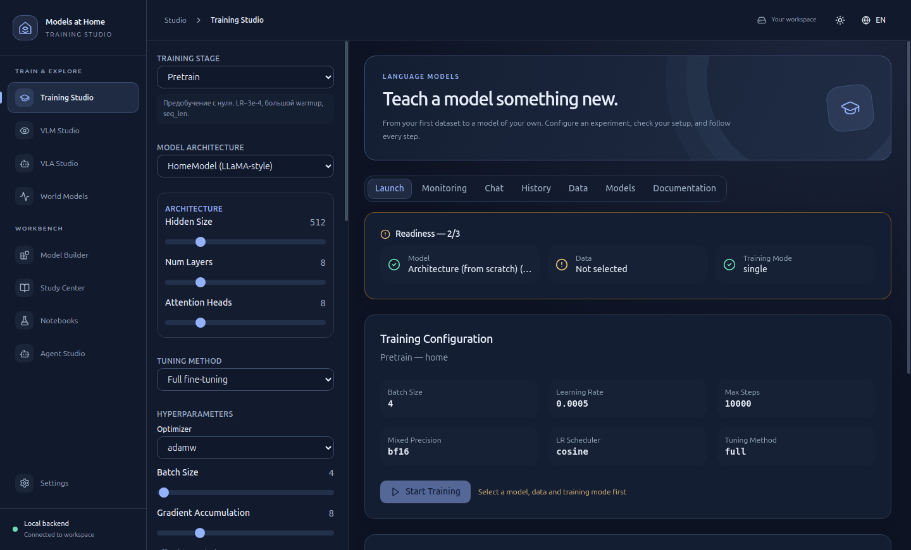
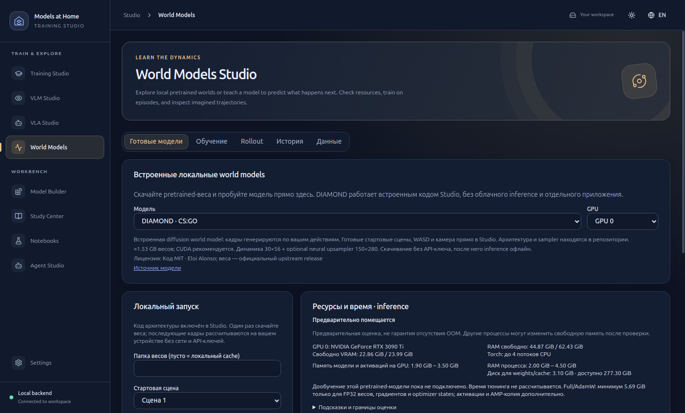
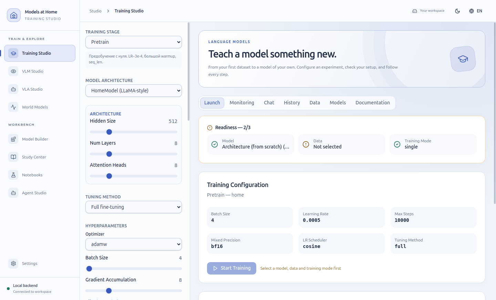

# 🏠 Models at Home

**Своя модель. Свои данные. Свои эксперименты.**

Models at Home — открытая студия для обучения моделей на своём компьютере.
Здесь можно собрать маленькую языковую модель с нуля, дообучить готовую,
научить модель работать с изображениями или попробовать модели действий и динамики среды.

Идея простая: меньше времени на склеивание скриптов, больше — на сами эксперименты.
Вы выбираете модель и данные, настраиваете обучение и наблюдаете, что получается,
в одном рабочем пространстве.



## Что можно делать

- **Обучать языковые модели.** Pretraining с нуля, продолжение обучения на своих текстах,
  SFT на инструкциях и диалогах, обучение с наградами через собственные GRPO / Dr.GRPO / DAPO / SDPO.
- **Работать с изображениями.** В VLM Studio есть SFT и native GRPO для vision-language моделей,
  пресеты Qwen3-VL, Qwen3.5 и Gemma 3, обычный Transformers и дополнительный Unsloth.
- **Учить модели действовать.** VLA Studio обучает по демонстрациям (SFT / behavior cloning):
  изображение, инструкция и состояние превращаются в действия. Поддерживаются непрерывные,
  дискретные и смешанные действия для робототехники, симуляторов и desktop-задач.
  Для continuous policies подключены отдельные OpenVLA, SmolVLA, ACT и π0 с собственными
  loss и генерацией действий. [Окружения, запуск и проверенные режимы](docs/VLA_POLICIES.md).
- **Исследовать world models.** Обучать собственные Latent GRU и Gaussian RSSM на эпизодах,
  смотреть предсказанные траектории или запускать встроенный локальный DIAMOND для Atari и CS:GO.
- **Собирать архитектуры.** Менять блоки и связи в Model Builder, строить looped Transformers
  с общими весами, GQA, MoE и residual-ветки. Есть редактируемые контейнеры, анализ параметров,
  черновик и undo/redo. В Research Lab можно открыть статью о блоке, посмотреть граф и формы
  тензоров, измерить активации и градиенты настоящим CPU-прогоном, сравнить варианты.
  Готовый backbone передаётся в LLM Studio или обучается с собственными image/action
  адаптерами в VLM/VLA Studio. [Конструктор](docs/MODEL_BUILDER.md) · [Research Lab](docs/RESEARCH_LAB.md).
- **Разбирать результаты.** Смотреть метрики, логи и историю запусков, продолжать совместимые
  чекпоинты и проверять модели в чате. В Agent Studio — помощник с локальным llama-server.
- **Учиться на примерах.** Встроенные ноутбуки с редактируемым Python, Markdown, выводом
  и графиками запускаются прямо в студии. 16 вводных уроков на русском и английском охватывают
  LLM/SFT/LoRA, RL, VLM, VLA, world models, архитектуры, looped Transformers и анализ обучения.
  Ещё 10 подробных [разборов статей](docs/PAPER_STUDIES.md) связывают формулы с кодом,
  диагностическими проверками и самостоятельными экспериментами. Всего 52 учебных `.ipynb`
  с учётом двух языков. Примеры работают на CPU без скачивания моделей.
  [Как пользоваться](docs/NOTEBOOKS.md).

Для текстовых и мультимодальных моделей доступны разные способы настройки весов,
включая Full, LoRA и QLoRA; точный набор зависит от архитектуры и выбранного backend.
Интерфейс работает на русском и английском. Есть тёмная тема и бело-серая светлая тема
в духе Streamlit, с красными кривыми loss и reward.

## Как устроен эксперимент

1. **Выберите раздел и модель.** Начните с небольшой архитектуры или готовой базы.
   Для VLA и собственных world models есть синтетические примеры без скачивания больших весов.
2. **Подготовьте данные.** Укажите локальный датасет или поддерживаемый источник Hugging Face.
   Формат зависит от задачи: тексты, диалоги, изображения с ответами или эпизоды с действиями.
3. **Проверьте настройки.** Используйте Readiness или preflight выбранного раздела.
   В World Models также есть оценка памяти и времени и короткий замер на вашем устройстве.
4. **Запустите обучение.** Следите за метриками и логами; результаты сохраняются в каталоге запуска.
5. **Попробуйте результат.** Откройте чат, Action preview или Rollout — в зависимости от типа модели.

Оценки памяти и времени помогают выбрать настройки, но не гарантируют, что любая модель
поместится на любой GPU. Сначала полезно сделать короткий пробный запуск.



## Первый запуск из исходников

Нужны **Node.js 22.12+**, **Python 3.12** и Git. Для серьёзного обучения рекомендуется
NVIDIA GPU с подходящей сборкой PyTorch/CUDA. Небольшие Native VLA и world-model демо
можно попробовать на CPU.

```bash
git clone https://github.com/researchim-ai/models-at-home.git
cd models-at-home
npm ci

python3 -m venv .venv
source .venv/bin/activate
python -m pip install --upgrade pip
python -m pip install -r backend/requirements.txt
python -m pip install -e ./models-at-home "transformers==4.57.3" datasets peft Pillow

npm run dev
```

На Windows активируйте окружение командой `.venv\Scripts\activate`.
PyTorch должен соответствовать вашему устройству; установка выше сама по себе не настраивает
CUDA-драйвер. Для quantization, Jupyter, Unsloth и отдельных семейств моделей нужны
дополнительные зависимости.

Команда `npm run dev` открывает Electron-приложение и запускает API. В Settings можно выбрать
режим **Native** для локального Python или **Docker** для контейнера; в режиме **Auto**
приложение пробует Docker и при необходимости переходит на локальный Python.

Если интерпретатор лежит в другом месте, задайте его явно:

```bash
MAH_PYTHON=/path/to/python npm run dev
```

Современные VLM используют отдельное окружение `.venv-vlm` или `MAH_VLM_PYTHON`:
инструкция по совместимым версиям находится в [руководстве VLM](docs/VLM_VALIDATION.md).
Для первого знакомства с VLA откройте **VLA Studio → Синтетическое демо**, выберите CPU / Float32,
выполните проверку и начните короткое обучение.

## Ваше рабочее пространство

Студия состоит из Electron/React-интерфейса, Python API и ML runtime в каталоге `models-at-home/`.
Обучение выполняют локальные процессы Python или Docker; это не клиент облачного API.
Первичная загрузка моделей и датасетов из Hugging Face требует сети, а некоторые веса —
принятия условий их авторов. Локальные данные, скачанные веса и результаты остаются на вашем диске.

В установленном приложении рабочие файлы хранятся в пользовательском `workspace`, отдельно от
ресурсов приложения. Путь можно изменить через `MODELS_AT_HOME_ROOT`.
Датасеты, веса, кеши и сборки не должны попадать в Git.



## Что стоит учитывать

Проект развивается: поддержка режима в одном разделе не означает поддержку во всех остальных.
В частности, **VLA сейчас обучается через SFT**, а **предобученный DIAMOND доступен для inference**;
обучение world models в интерфейсе относится к собственным GRU/RSSM.
Поддержка Unsloth, QLoRA, multi-GPU и продолжения обучения зависит от конкретного пути запуска.

Для воспроизводимого эксперимента начинайте с подходящего окружения и короткой проверки.
Поддерживаемые форматы, зависимости и границы проверок описаны отдельно:

- [VLM: модели, SFT, native GRPO и Unsloth](docs/VLM_VALIDATION.md)
- [VLA: демонстрации, action spaces и обучение](docs/VLA_STUDIO.md)
- [World Models: обучение динамики и Rollout](docs/WORLD_MODELS_STUDIO.md)
- [DIAMOND и другие локальные world models](docs/WORLD_FOUNDATION_MODELS.md)

## Сайт проекта

В каталоге [`web/`](web/README.md) — отдельный сайт на английском и русском: обзор студии,
реальные скриншоты, Research Lab и инструкции запуска. Локально: `cd web && npm run dev`.

## Для разработчиков

```bash
npm run typecheck
npm test
python -m pip install -r backend/requirements-dev.txt
python -m pytest backend/tests -q
npm run build
```

`npm run build` собирает интерфейс и пакет приложения для текущей ОС.
Также есть команды `build:linux`, `build:win` и `build:mac`; доступность конкретного пакета
зависит от платформы сборки. Python-окружение и веса моделей устанавливаются отдельно.

Исходники интерфейса находятся в `src/`, Electron — в `electron/`, API и workers — в `backend/`,
ML-код — в `models-at-home/homellm/`. Для проверки собранного приложения с настоящим backend
есть `scripts/smoke-desktop.cjs`. Скриншоты в этом README сняты с работающего приложения.

Нашли ошибку или хотите добавить архитектуру? Создайте issue с конфигурацией запуска,
версией окружения и логом ошибки — так проблему будет гораздо проще воспроизвести.
