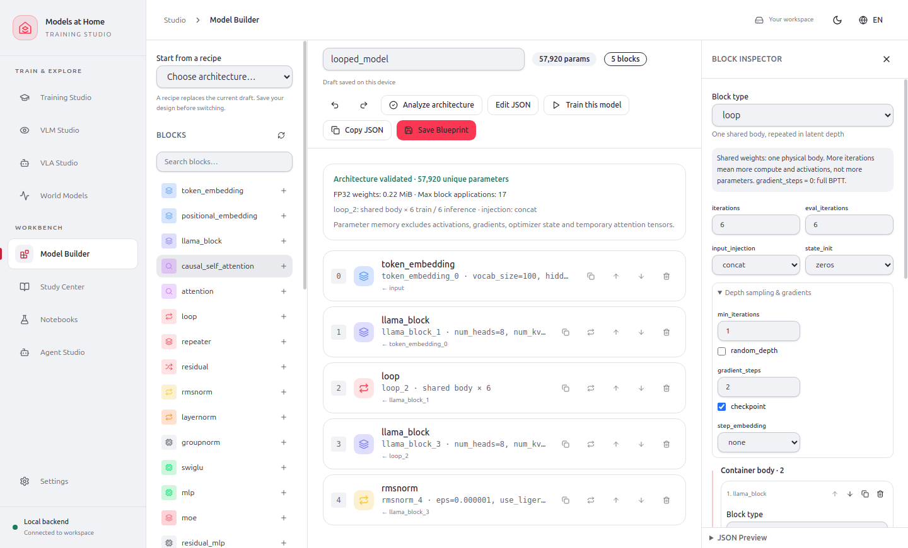

# Model Builder: собственные архитектуры и looped transformers

Model Builder собирает **собственные causal language models из блоков**. Это редактор
blueprint-архитектур для обучения с нуля и дальнейшего SFT, а не конвертер весов любой
готовой Hugging Face модели в произвольный граф. Совместимый causal backbone также
можно обучить с native image/text или image/text/state/action адаптерами в VLM/VLA Studio.
[Research Lab](RESEARCH_LAB.md) описывает карточки с первоисточниками, граф, формы,
реальные CPU probes, сравнение вариантов и наблюдение во время обучения.

## Начать в интерфейсе

1. Откройте **Model Builder → Start from a recipe**. Есть обычный Transformer,
   Looped Transformer с общим core и MoE с residual-ветками. Выбор рецепта заменяет
   черновик; Undo возвращает предыдущую архитектуру.
2. Выберите размер скрытого состояния, словарь и длину контекста. Стандартные
   размерности вложенных блоков обновляются вместе с ними; явно заданные другие ширины сохраняются.
3. Нажмите на блок. В **Block inspector** можно заменить его тип, менять параметры,
   добавлять, копировать, переставлять и удалять блоки внутри контейнеров.
4. Для ветвления выберите входы среди более ранних блоков. `add` складывает одинаковые
   ширины, `multiply` умножает две такие ветки, `concat` объединяет их по скрытой размерности.
   После `concat` при необходимости добавьте `linear` с подходящим `in_features`.
5. **Analyze architecture** проверяет контракт графа и считает реальные уникальные
   параметры на meta-device, без размещения весов на GPU. Число вызовов блоков показывает
   максимальный развёрнутый план, включая вложенные контейнеры.
6. Сохраните blueprint. Измените имя, чтобы сохранить другую версию. **Train this model**
   передаст снимок архитектуры в Training Studio; там нужно выбрать tokenizer и данные.

Черновик автоматически хранится в локальном хранилище интерфейса, включая изменения
после навигации и перезагрузки. Undo/Redo доступны для последних 50 изменений текущего
сеанса. Отдельно сохраняйте важные версии как blueprints; ещё не применённый JSON-текст
не считается частью сохранённого черновика.



## Что означает loop

Обычный `repeater` создаёт **N независимых копий** блока. `loop` создаёт тело **один раз**
и несколько раз применяет одни и те же параметры к изменяющемуся скрытому состоянию.
Это recurrence по глубине, а не генерация нескольких текстовых ответов.

В теле loop можно собрать последовательность поддерживаемых hidden-state блоков,
включая Transformer, norm, MLP, MoE и residual-контейнеры. Итоговая ширина тела должна
совпадать с шириной его входа. Embeddings и графовые join-операции размещаются снаружи.

- `iterations` — глубина при обучении; `eval_iterations` — при inference.
- `input_injection=none` — обычное повторное применение тела к предыдущему состоянию.
- `input_injection=add` — на каждом шаге `(state + input) / sqrt(2)`.
- `input_injection=concat` — общая обучаемая проекция `[state; input] → hidden` на каждом шаге.
- `state_init=input|zeros` — исходное состояние. Нулевой старт требует подачи входа в core,
  чтобы модель могла учитывать токены запроса.
- `step_embedding=sinusoidal` — дополнительное кодирование номера итерации.
  Это отдельный экспериментальный вариант; оно не равно token-position RoPE.

В рецепте Looped Transformer есть отдельные prelude и coda, общий core с подачей входа
через concat-проекцию и sandwich-нормализациями. Это **упрощённый собственный рецепт**,
вдохновлённый recurrent-depth архитектурами, не полная реализация Huginn или его checkpoint.

Увеличение iterations не добавляет копий весов, но увеличивает время вычислений и может
увеличить память активаций. Оценка FP32 weights в анализаторе **не включает** активации,
градиенты и optimizer state и не является гарантией, что обучение поместится в VRAM.

## Градиенты и глубина обучения

Раздел **Depth sampling & gradients** в инспекторе loop содержит дополнительные настройки:

- `gradient_steps=0`: полный backprop через все итерации; хороший исходный режим для маленького опыта.
- `gradient_steps=k`: первые итерации вычисляются без autograd, градиент проходит только
  через последние k. Подача исходного входа на каждом шаге сохраняет путь градиента к prelude.
  Без injection при глубине больше k этот путь может обрываться; анализатор предупреждает об этом.
- `checkpoint=true`: пересчёт тела в backward вместо хранения части активаций, с дополнительной ценой по времени.
- `random_depth=true`: одна глубина на forward выбирается равномерно от `min_iterations`
  до `iterations`. При eval используется фиксированный `eval_iterations`.

Uniform sampling здесь намеренно проще распределения из Huginn. Чекпоинт хранит
архитектуру и её настройки; существующий worker сохраняет и продолжает обучение.
AMP-кеш преобразованных весов отключается внутри training loop при TBPTT/checkpointing:
иначе no-grad итерации могут оставить detached casts и потерять градиенты в обучаемой части.
Это проверяется отдельными CPU BF16 autograd-тестами.

Не следует ожидать, что дополнительные inference-итерации автоматически улучшат качество.
Сравнивайте бюджеты на отдельной validation-выборке. В Python доступен явный override:

```python
model.eval()
result = model.generate(input_ids, max_new_tokens=16, use_cache=False, loop_iterations=8)
```

Модель сейчас пересчитывает контекст и не реализует depth-indexed KV cache, ACT/halting,
DEQ или self-speculative decoding. Loop нельзя ускорить, просто переиспользуя один KV cache
для всех итераций: скрытые состояния на разных глубинах различаются.

## Другие техники

Доступны MHA/GQA (`num_kv_heads` делит `num_heads`), RoPE, SwiGLU/MLP, sparse MoE,
pre-norm и sandwich-norm, residual-ветки, `add`/`multiply`/`concat`, causal convolutions,
dropout и линейные проекции. Для ReZero используйте `residual` с `scale=0` и
`learnable_scale=true`. `Wrap block in loop` превращает один блок в редактируемый общий core;
`Duplicate block` добавляет независимый слой в последовательную архитектуру.

Для нелинейного графа нельзя безопасно переставить или скопировать ветку как простой список:
используйте входы в инспекторе и проверку графа либо Edit JSON. Циклы в самом DAG запрещены;
recurrence задаётся явным loop-контейнером с конечным бюджетом.

Нельзя автоматически поддержать любую новую технику лишь добавлением пункта в меню.
В категории Advanced сохранены `custom_op`, `inline_code`, `permute` и pooling.
Они позволяют прототипировать локальные Python-операторы и нестандартные преобразования;
их causal-контракт и согласование labels проверяйте самостоятельно. Analyze architecture
не исполняет пользовательский код и явно отказывается подтверждать такие схемы.

Для расширения архитектуры:

1. Зарегистрируйте builder в `models-at-home/homellm/models/blocks/`. Он возвращает
   `(module, output_width)` и соблюдает контракт `[batch, sequence, hidden]`, causal mask
   и padding. Для входов attention используйте параметр `attention_mask`.
2. Добавьте описание и defaults в `backend/services/blueprint_catalog.py`.
   Интерфейс автоматически построит основные поля; вложенные параметры можно применять через Parameters JSON.
3. Добавьте правила размерностей и параметров в `backend/services/blueprints.py`.
4. Проверьте forward/backward, causal/padding-инварианты, сохранение и загрузку, а не только создание класса.

## Примеры и проверки

Готовые JSON: [looped-transformer](../examples/model-builder/looped-transformer.json) и
[gated-branches](../examples/model-builder/gated-branches.json). Вставьте содержимое в Edit JSON
или используйте их через API сохранения blueprint.

```bash
npm run typecheck
npm test
python -m pytest backend/tests -q
python scripts/smoke-training.py --architecture looped --cpu
```

Python должен видеть установленный пакет `homellm`, Torch и ML-зависимости. Если запускаете
без editable install, задайте `PYTHONPATH="$PWD/models-at-home"`.

Для собранного desktop-приложения включите `MAH_SMOKE_BUILDER=1` при запуске
`scripts/smoke-desktop.cjs`. Проверка редактирует core, сравнивает число параметров при
разной глубине, проверяет undo, сохранение черновика и передачу схемы в обучение.

Проверены маленькие CPU-модели: optimizer updates, save/reload, generation, pretrain,
resume, SFT chat/instruct; отдельно — checkpoint gradients, TBPTT, CPU BF16 AMP,
GQA и padding, graph joins и MoE auxiliary loss. Это проверка корректности механизмов,
не доказательство качества большой модели; CUDA, multi-GPU и крупные обучающие прогоны
для этих новых архитектур требуют отдельных измерений.

## Исходные работы

- [Universal Transformers](https://arxiv.org/abs/1807.03819): общая transition-функция по глубине и кодирование шагов.
- [Scaling up Test-Time Compute with Latent Reasoning](https://arxiv.org/abs/2502.05171): prelude/core/coda, input injection и truncated backprop.
- [Код авторов recurrent-depth работы](https://github.com/seal-rg/recurrent-pretraining).
- [GQA](https://arxiv.org/abs/2305.13245): группировка query-heads вокруг меньшего числа KV-heads.
- [ReZero](https://arxiv.org/abs/2003.04887): residual-ветка с нулевым начальным обучаемым масштабом.
