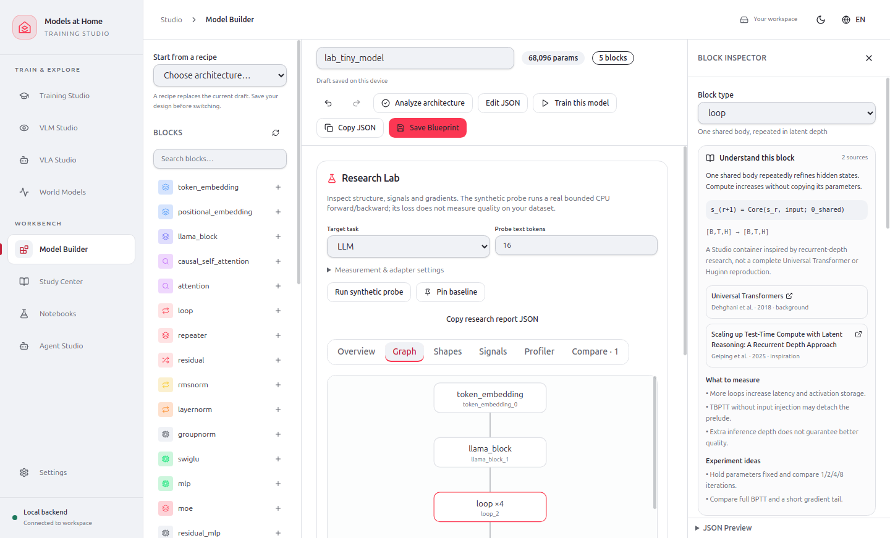

# Research Lab: от гипотезы до обучаемой модели

Model Builder — место, где можно собрать архитектуру, понять её устройство, поставить
небольшой эксперимент и передать результат в LLM, VLM или VLA Studio.
Начните с рецепта **CPU Research Lab**: он достаточно мал для пробного запуска без GPU.



## Изучить блок и архитектуру

Выберите блок в списке или во вкладке **Graph**. В инспекторе раскройте
**Understand this block**: там есть назначение, формула, контракт размерностей,
компромиссы и идеи экспериментов. Ссылки ведут на первичные работы или код реализации.
Карточки различают источник метода, связанные исследования и собственную реализацию:
например, Llama-style блок не означает загрузку весов LLaMA. У элементарных операций
не приписывается выдуманный автор.

Выберите **Target task**, затем нажмите **Analyze architecture**. Анализ строит модель
на meta-device без размещения реальных весов. Он показывает уникальные параметры,
максимальное число применений блоков, оценку вычислений отдельно для train/eval,
формы тензоров и совместимость с адаптерами. Вложенные строки включают своих детей:
складывать их параметры нельзя. **Shapes** позволяет вернуться из строки к инспектору.

В оценках памяти отдельно показаны FP32-веса и нижняя граница «веса + градиенты + Adam».
Это не полная память обучения: активации, временные буферы, allocator и особенности GPU
требуют реального замера. MACs — оценка dense/attention вычислений, без полной стоимости
элементных операций, маршрутизации и передачи памяти; это не прогноз времени обучения.

## Проверить, что внутри действительно происходит

**Run synthetic probe** выполняет настоящий CPU FP32 forward/backward и 1–5 шагов AdamW.
В **Signals** видны loss, изменение весов, активации, конечность значений, градиенты
и первые вызовы recurrent core. Проверка causality меняет будущий токен и измеряет
изменение предыдущих выходов. Для VLM/VLA дополнительно меняется изображение и
измеряется влияние на текстовые признаки. Это проверяет путь сигнала, а не качество зрения.

**Profiler** показывает реальные CPU-операторы отдельного forward/backward. Время
включает накладные расходы инструментария и не является ETA для GPU. Peak RSS относится
ко всему процессу. Shared loops и checkpointing увеличивают число вызовов; отсутствие
градиента может быть связано с маршрутизацией MoE или truncated BPTT и требует интерпретации.
Embedding hook в мультимодальном режиме наблюдает lookup текстовых байтов до fusion;
статическая схема показывает уже общий image/text контекст.

Проба изолирована в subprocess с таймаутом 90 секунд, максимумом 8 млн параметров,
batch ≤ 4 и text tokens ≤ 64. Дополнительно ограничивается сумма объёмов выходных тензоров
(32 MiB); это защитный proxy, не оценка всех живых активаций. Проверяется доступная RAM.
Custom Python и операции с непроверенным контрактом осей автоматически не исполняются.

Архитектура и профиль имеют fingerprints. При редактировании старые результаты скрываются.
**Pin baseline** сохраняет независимый снимок схемы, профиля и компактного результата;
в **Compare** можно оставить гипотезу и восстановить вариант. До шести baseline хранятся
локально. Synthetic inputs используют отдельный seeded generator; fingerprint входов
показывает, можно ли сравнивать опыт как контролируемую абляцию. Synthetic loss не заменяет
validation на настоящих данных. **Copy research report JSON** копирует схему и результаты.

## Обучить собранную архитектуру

- **LLM:** Train this model передаёт снимок causal blueprint в Training Studio.
  Выберите tokenizer и данные; доступны существующие pretrain/SFT пути.
- **VLM:** Train in VLM Studio добавляет обучаемую patch projection, позиции image patches
  и language head. Контекст содержит image prefix и текст. Поддерживаются native full-weight
  SFT и pretrain, одно локальное изображение на пример, байтовый словарь из 259 токенов.
  **Load local research demo** даёт маленький готовый датасет без скачивания весов.
- **VLA:** Train in VLA Studio использует тот же causal backbone с image prefix, инструкцией,
  нормализованным состоянием и action head. Существующий supervised trainer обучает continuous,
  discrete или hybrid действия и последовательности действий.

VLM/VLA адаптеры обучаются **с нуля**, без pretrained visual encoder. Они требуют совместимого
causal backbone с перемешиванием токенов; несовместимые блоки/контекст отклоняются.
Исходная схема и эффективная схема со словарём 259 сохраняются отдельно вместе с хешами.
Редактирование builder после передачи не меняет уже выбранный снимок обучения.
Чекпоинты содержат модель и состояния обучения; результат можно экспортировать и загрузить
для генерации текста с изображением или предсказания действий.

Для этих новых blueprint-адаптеров реализовано full-weight supervised обучение.
GRPO, Unsloth, LoRA и QLoRA для них пока не реализованы. Возможности готовых HF-моделей
в существующих разделах остаются отдельными путями; одинаковое название задачи не означает
совместимость всех методов обучения.

## Наблюдать настоящий запуск

Опция research diagnostics включает сбор сигналов на первом и каждом 20-м optimizer step.
В страницах обучения появляются формы, sampled activation RMS/std и gradient RMS по блокам.
Статистика берётся с последнего microbatch и максимум первых 4096 элементов каждого тензора;
до 64 модулей, только скаляры без удержания autograd graph. Gradient stage указывает,
в какой момент trainer измерил градиенты. Вложенные строки пересекаются по параметрам.
Эти сигналы относятся к реальному датасету и отображаются отдельно от synthetic probe.

## Воспроизвести проверки

```bash
npm run typecheck
npm test
PYTHONPATH="$PWD/models-at-home" python -m pytest backend/tests -q
PYTHONPATH="$PWD/models-at-home" python scripts/smoke-research-lab.py
PYTHONPATH="$PWD/models-at-home" python scripts/smoke-training.py --architecture looped --cpu
```

Нужны ML-зависимости backend. Native smoke действительно обучает маленькие VLM/VLA,
проверяет изменение vision-весов, диагностику, resume, неизменность снимка, экспорт и inference.
Desktop smoke с `MAH_SMOKE_RESEARCH=1` проверяет настоящий probe в упакованном Electron,
ссылки, граф, baseline, темы и переходы к обучению. `MAH_SMOKE_BUILDER=1` дополнительно
проверяет редактирование loop. CUDA, большие модели, качество на реальных задачах и
multi-GPU требуют отдельных экспериментов.
