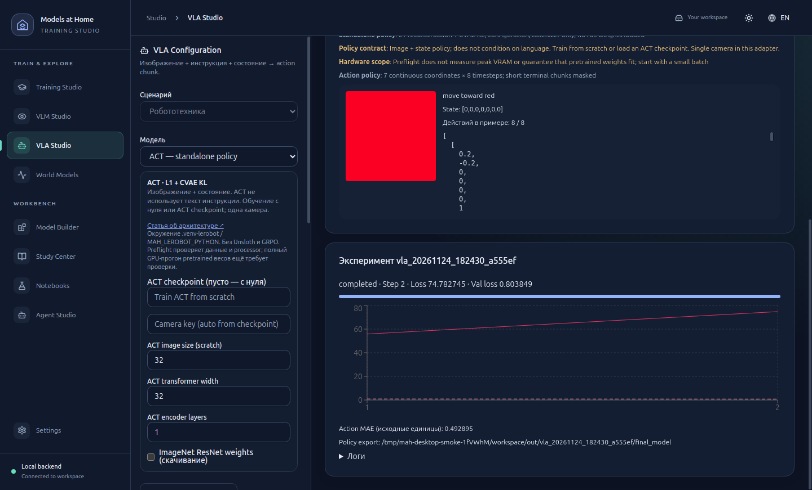

# OpenVLA, SmolVLA, ACT и π0 в VLA Studio

В меню **VLA architecture** есть четыре самостоятельные политики. Они используют
собственные модели, objective и генерацию действий; существующая VLM + Action Head
остаётся отдельным вариантом. Обучение выполняется локально, без облачного API.



## Выбрать политику

- **ACT** — реализация LeRobot Action Chunking Transformer: ResNet, transformer и CVAE;
  loss L1 + KL. При пустом model path обучается с нуля. Можно включить загрузку ImageNet
  весов ResNet или указать совместимый ACT checkpoint. Вход — одна камера и state;
  **текст инструкции ACT не использует**. Ширину и число encoder layers можно менять
  при обучении с нуля. У готового checkpoint архитектура берётся из его config.
- **SmolVLA** — `lerobot/smolvla_base`, pretrained VLM и action expert, flow matching.
  Вход — изображение, инструкция и state. По умолчанию обучается expert при замороженном
  VLM; Train action expert only и Freeze vision encoder управляют заморозкой. Full
  означает обучение без LoRA, а не обязательную разморозку всех весов.
- **π0** — `lerobot/pi0_base`, PyTorch-порт OpenPI из LeRobot: PaliGemma и action expert,
  flow matching и ODE-генерация action chunks. Настройки заморозки аналогичны SmolVLA.
  В текущем адаптере **все строки train и holdout должны содержать полный chunk**:
  upstream π0 objective не маскирует terminal padding.
- **OpenVLA** — оригинальная `openvla/openvla-7b`, autoregressive action-token policy.
  Используется её собственная vocabulary discretization и cross entropy по action tokens
  и EOS. Реализованы Full и LoRA. Контракт: **action_dim=7, horizon=1, state_dim=0**,
  последнее значение — gripper в [0,1]. State не передаётся и не отбрасывается молча.
  Preflight и обучение требуют CUDA; уменьшенный численный тест доступен на CPU отдельно.

Все четыре адаптера принимают **continuous actions**. Discrete/hybrid сценарии остаются
в Native VLA, Blueprint и VLM + Action Head. Unsloth, QLoRA и GRPO для этих четырёх
самостоятельных политик не подключены. Это supervised imitation learning.

Для SmolVLA/π0 поддерживаются state/action размерности 1..32 и chunk size из checkpoint
(у указанных баз 50). ACT checkpoint требует точного совпадения state/action dimensions
и chunk size. Для многокамерных SmolVLA/π0 checkpoint текущий JSONL adapter подаёт одну
камеру: **Policy camera key** выбирает слот. Остальные слоты обрабатываются штатным
upstream механизмом отсутствующих камер. ACT adapter поддерживает одну камеру.
ALoHA-specific и relative-action преобразования этим адаптером не выполняются;
checkpoint, требующий таких преобразований, отклоняется.

## Установить отдельные окружения

Для этих отдельных окружений выберите **Settings → Backend → Native**.
Основное API/LLM окружение менять не нужно. Нужен Python 3.12. Сначала установите в новое
окружение Torch 2.9.1 / torchvision 0.24.1 с CPU или CUDA wheels под своё устройство,
затем зависимости. Пример для Linux/macOS:

```bash
python3 -m venv .venv-lerobot
.venv-lerobot/bin/python -m pip install --upgrade pip
.venv-lerobot/bin/python -m pip install -r backend/requirements-lerobot.txt

python3 -m venv .venv-openvla
.venv-openvla/bin/python -m pip install --upgrade pip
.venv-openvla/bin/python -m pip install -r backend/requirements-openvla.txt
```

На Windows используйте `Scripts/python.exe` вместо `bin/python`.
LeRobot закреплён на **0.7.0 / Transformers 5.22.0**, OpenVLA — на
**Transformers 4.40.1 / timm 0.9.10 / PEFT 0.11.1**. Это разные worker-процессы:
их зависимости не импортируются в основное API при выборе модели.

Приложение автоматически находит `.venv-lerobot` и `.venv-openvla` рядом с исходниками.
Для установленного desktop или другого расположения задайте пути при запуске:

```bash
MAH_PYTHON=/path/to/api/python \
MAH_LEROBOT_PYTHON=/path/to/lerobot/python \
MAH_OPENVLA_PYTHON=/path/to/openvla/python npm run dev
```

Для первого скачивания весов/processor нужна сеть и, при необходимости, `HF_TOKEN`
с доступом к модели/tokenizer. OpenVLA загружается через официальный HF remote code;
поле **OpenVLA revision** позволяет закрепить commit модели и кода.

## Подготовить данные и запустить

Используется существующий [JSONL-контракт VLA Studio](VLA_STUDIO.md): локальное изображение,
инструкция, state, явный action chunk. Действия должны иметь согласованные координаты,
единицы и частоту. Политика предсказывает числа; приложение не управляет роботом или ОС.

Для ACT можно начать с **Синтетического демо**: CPU / Float32, batch 1–2, 2–10 steps,
небольшие image size и transformer width. Для остальных синтетическая кнопка отключена,
поскольку стандартные демо не соответствуют их контрактам horizon/state/action.
Укажите свой совместимый JSONL или используйте уменьшенные тестовые fixtures ниже.

1. Выберите политику. Интерфейс подставит базовую модель и стартовые настройки.
2. Укажите train/holdout, размерности, horizon и при необходимости camera key.
3. Нажмите **Проверить VLA**. Проверяются все строки и формы, декодирование первых 200
   изображений каждого split, processor/tokenizer, длина инструкции без silent truncation,
   размерности и chunk size checkpoint. Полные веса на preflight не загружаются.
4. Запустите обучение. Доступны optimizer/action loss, validation loss, MAE в исходных
   единицах, checkpoints, остановка и продолжение через общий API.
5. В **Action preview** укажите экспорт `final_model`, изображение, инструкцию и state.
   Возвращается action chunk. Внутренние inference queues сбрасываются для каждого preview.

Preflight **не гарантирует**, что полная модель поместится в VRAM. Full OpenVLA/π0 очень
требовательны к памяти; начинайте с batch 1, заморозки или LoRA там, где она реализована.
Полноразмерные pretrained GPU-прогоны в этой поставке не проверены.

## Нормализация и сохранение

State и continuous actions для LeRobot нормализуются один раз по mean/std **только train**.
ACT adapter использует фиксированные ImageNet visual mean/std; SmolVLA/π0 получают RGB
в [0,1] и штатную model preprocessing. Изображение приводится к нужному размеру;
у SmolVLA/π0 сохраняются пропорции с padding. Это Studio JSONL adapter, а не импорт
любого внешнего processor pipeline без проверки его семантики.

OpenVLA использует train q01/q99, clipping в [-1,1] для первых шести координат и
ненормализованный gripper. Эти статистики сохраняются и используются для обратного
преобразования. Они не берутся из holdout и не подменяются статистиками исходного робота.

Экспорт содержит `policy.json`, официальные policy weights/config и необходимые processor/
tokenizer assets. Для SmolVLA также сохраняются VLM config/processor assets, чтобы повторная
загрузка не требовала заново скачивать базовые VLM-веса. OpenVLA LoRA export сохраняет
ссылку на исходную базу: она нужна при загрузке адаптера. Optimizer checkpoints дополнительно
содержат scheduler, RNG, порядок данных, cursor и fingerprint конфигурации/JSONL.
Хеш JSONL не является хешем содержимого всех файлов изображений.

## Что реально проверено

- ACT: настоящий LeRobot CPU train/validation, изменение весов, побитово точный resume,
  официальный экспорт и action-chunk inference.
- SmolVLA: тот же полный lifecycle через API/worker на уменьшенной настоящей архитектуре
  со случайными начальными весами; это не проверка качества опубликованной base policy.
- OpenVLA: уменьшенная настоящая OpenVLA architecture, Full и LoRA, objective/градиенты,
  optimizer update, генерация и одинаковый inference после reload.
- π0: уменьшенные размерности upstream моделей, настоящий flow objective, expert update,
  ODE sampling и roundtrip весов. Forward/backward/sampling не заменяются mock-реализацией.
- API/UI: несовместимые методы и формы, выбор окружения, action-token masks, gripper contract,
  ограничения padding и сброс preflight при смене политики.

Воспроизведение (Torch wheels установлены, нужные окружения готовы):

```bash
MAH_LEROBOT_PYTHON="$PWD/.venv-lerobot/bin/python" \
PYTHONPATH="$PWD/models-at-home" python scripts/smoke-vla-policies.py

.venv-lerobot/bin/python scripts/create-vla-policy-fixture.py --policy smolvla --output /tmp/mah-smol-fixture
MAH_LEROBOT_PYTHON="$PWD/.venv-lerobot/bin/python" \
PYTHONPATH="$PWD/models-at-home" python scripts/smoke-vla-policies.py --architecture smolvla --model-path /tmp/mah-smol-fixture/policy

.venv-lerobot/bin/python scripts/smoke-pi0-core.py

.venv-openvla/bin/python scripts/create-vla-policy-fixture.py --policy openvla --output /tmp/mah-openvla-fixture
.venv-openvla/bin/python scripts/smoke-openvla-core.py --model-path /tmp/mah-openvla-fixture/policy
```

Fixture-генератор скачивает только configs/processors; создаёт случайные малые веса.
Не сохраняйте их в Git. Для обоих fixture каталогов нужен новый, ещё не существующий путь.
Скрипт API lifecycle запускайте из основного API Python с dev/ML зависимостями.

## Первоисточники

- [ACT / Learning Fine-Grained Bimanual Manipulation](https://arxiv.org/abs/2304.13705), [LeRobot ACT](https://huggingface.co/docs/lerobot/act).
- [SmolVLA](https://arxiv.org/abs/2506.01844), [официальное руководство](https://huggingface.co/docs/lerobot/smolvla).
- [π0](https://arxiv.org/abs/2410.24164), [OpenPI](https://github.com/Physical-Intelligence/openpi), [LeRobot π0](https://huggingface.co/docs/lerobot/pi0).
- [OpenVLA](https://arxiv.org/abs/2406.09246), [официальный код и fine-tuning](https://github.com/openvla/openvla).
